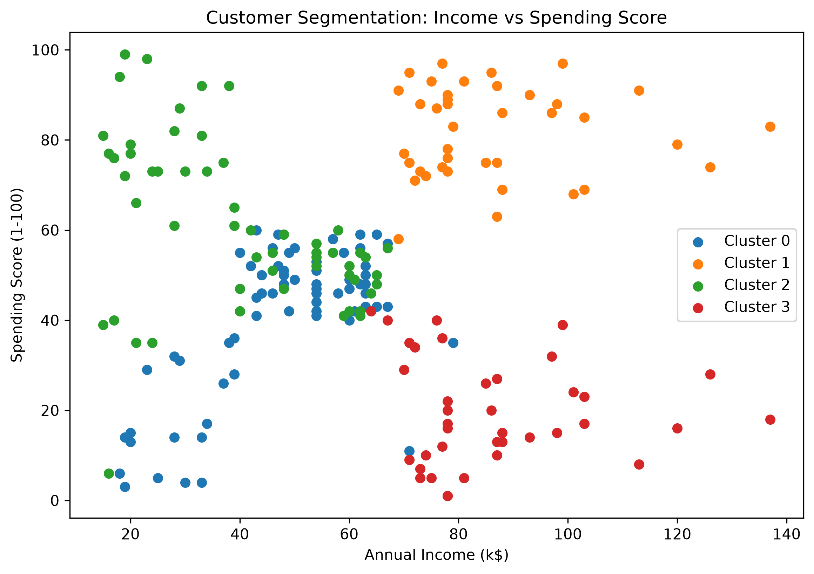
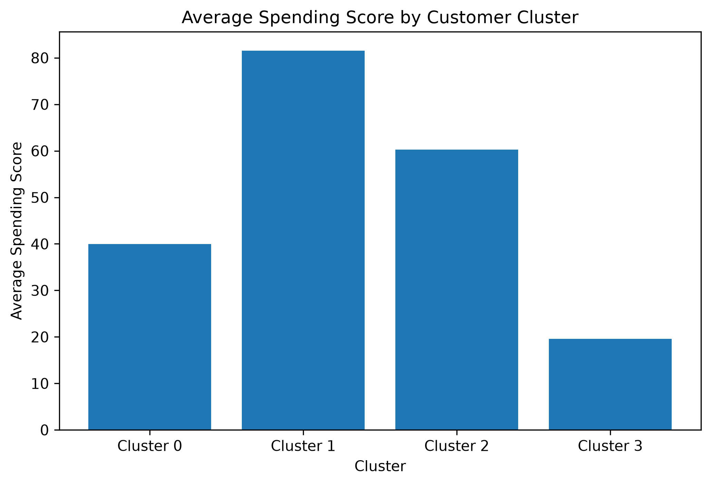
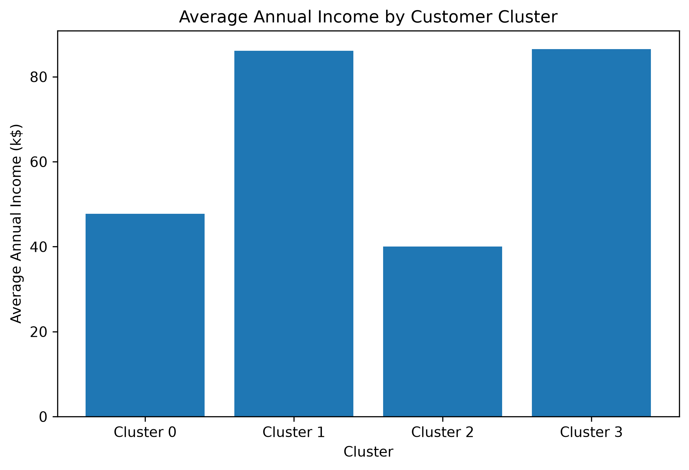

# Customer Segmentation Using Data Analysis & Clustering

## Project Overview

This project performs customer segmentation using exploratory data analysis and K-Means clustering. The objective is to group customers based on their age, annual income, and spending behavior.

The project uses the Mall Customers dataset and applies data preprocessing, exploratory analysis, feature scaling, the Elbow Method, and K-Means clustering.

## Problem Statement

Businesses have customers with different demographic characteristics, income levels, and spending behaviors. Understanding these customer groups can help businesses identify distinct customer segments and support targeted marketing and customer engagement strategies.

## Objectives

- Analyze customer demographic and spending patterns.
- Explore relationships between age, income, and spending score.
- Identify meaningful customer groups using K-Means clustering.
- Determine the appropriate number of clusters using the Elbow Method.
- Analyze the characteristics of each customer segment.
- Generate visualizations and business insights from the clusters.

## Dataset

The dataset used is the Mall Customers dataset.

### Dataset Features

- `CustomerID` - Unique customer identifier.
- `Gender` - Customer gender.
- `Age` - Customer age.
- `Annual Income (k$)` - Annual income in thousands of dollars.
- `Spending Score (1-100)` - Spending score assigned to the customer.

### Dataset Size

- Rows: 200
- Columns: 5
- Missing values: 0
- Duplicate rows: 0

## Tools and Technologies

- Python
- Pandas
- NumPy
- Matplotlib
- Seaborn
- Scikit-learn
- Jupyter Notebook
- VS Code

## Data Preprocessing

The dataset was checked for:

- Missing values
- Duplicate records
- Data types
- Statistical characteristics

No missing values or duplicate records were found.

`CustomerID` was treated as an identifier and was not used as a clustering feature.

The following features were used for clustering:

- Age
- Annual Income (k$)
- Spending Score (1-100)

The features were standardized using `StandardScaler` before applying K-Means.

## Exploratory Data Analysis

The following analyses were performed:

- Age distribution
- Annual income distribution
- Spending score distribution
- Age vs spending score
- Annual income vs spending score
- Correlation heatmap

The analysis showed that customers have different combinations of age, income, and spending behavior, making clustering useful for identifying customer groups.

## K-Means Clustering

The Elbow Method was used to determine the appropriate number of clusters.

Based on the WCSS curve, **4 clusters** were selected for the K-Means model.

The K-Means algorithm was then applied with:

- Number of clusters: 4
- Random state: 42
- Number of initializations: 10

## Cluster Evaluation

The Silhouette Score for the 4-cluster solution was:

**0.404**

This indicates moderate separation between the customer clusters.

## Cluster Analysis

| Cluster | Customers | Average Age | Average Income (k$) | Average Spending Score |
|---------|-----------|-------------|----------------------|------------------------|
| Cluster 0 | 65 | 53.98 | 47.71 | 39.97 |
| Cluster 1 | 40 | 32.88 | 86.10 | 81.53 |
| Cluster 2 | 57 | 25.44 | 40.00 | 60.30 |
| Cluster 3 | 38 | 39.37 | 86.50 | 19.58 |

### Cluster Characteristics

**Cluster 0**
- Average age: 53.98
- Average income: 47.71k
- Average spending score: 39.97
- Older customers with medium income and medium-low spending.

**Cluster 1**
- Average age: 32.88
- Average income: 86.10k
- Average spending score: 81.53
- Younger customers with high income and high spending.

**Cluster 2**
- Average age: 25.44
- Average income: 40.00k
- Average spending score: 60.30
- Young customers with medium income and relatively high spending.

**Cluster 3**
- Average age: 39.37
- Average income: 86.50k
- Average spending score: 19.58
- Customers with high income and low spending.

## Business Insights

- Customers can be divided into four distinct groups based on age, income, and spending behavior.
- High income does not necessarily mean high spending.
- Clusters 1 and 3 have similar average incomes but very different spending scores.
- Younger customers appear in both medium-income/high-spending and high-income/high-spending groups.
- Customer segmentation can help businesses understand differences in customer behavior.
- Different customer groups can be analyzed separately for targeted marketing and engagement strategies.

## Visualizations

### Customer Segmentation



### Average Spending Score by Cluster



### Average Income by Cluster



## Conclusion

The project successfully applied K-Means clustering to segment 200 customers using age, annual income, and spending score.

Four customer clusters were identified using the Elbow Method. The resulting clusters showed meaningful differences in customer age, income, and spending behavior.

The analysis demonstrates how unsupervised machine learning can be used to discover customer groups and generate useful business insights from customer data.

## Future Scope

- Test other clustering algorithms such as DBSCAN and Hierarchical Clustering.
- Compare different clustering evaluation metrics.
- Include additional customer attributes when available.
- Develop an interactive dashboard for exploring customer segments.
- Use larger and more diverse customer datasets.
- Apply the segmentation results to personalized marketing strategies.

## Project Structure

```text
Qskill_customer_segmentation/
│
├── Dataset/
│   ├── Mall_Customers.csv
│   └── Mall_Customers_Segmented.csv
│
├── Notebook/
│   └── Customer_Segmentation.ipynb
│
├── Readme/
│   └── README.md
│
└── Visualization/
    ├── customer_segments.png
    ├── average_spending_by_cluster.png
    └── average_income_by_cluster.png